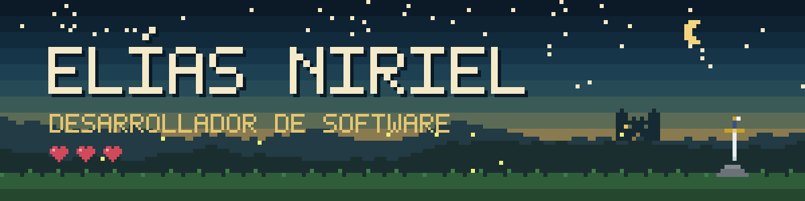

<h3><i>“Cada bug es solo otra mazmorra por explorar.”</i></h3>

<table>
<tr>
<td width="62%" valign="middle">

### 🗡️ Sobre mí

¡Hola! Soy **Elías Niriel López**, desarrollador de software junior.

Egresé del **Bachillerato Técnico Vocacional en Desarrollo de Software** en el **Colegio Español Padre Arrupe** y estoy por empezar la universidad.

Disfruto construir **backends y APIs REST**, apps **móviles y web**, y meterme en proyectos que me obliguen a aprender algo nuevo. Cuando no estoy programando, probablemente estoy en algún juego de aventura o mejorando alguno de mis proyectos personales.

🏆 Ganador **CIMAT 2026** con *Togo* &nbsp;·&nbsp; 🏆 Ganador **Eureka 2026** con *LESSAI*

</td>
<td width="38%" align="center" valign="middle">

</td>
</tr>
</table>

### 🎒 Inventario

 

 

 

 

· SQL Server · MariaDB

 

### 📜 Misiones completadas

| | Proyecto | Descripción | Tecnologías |
| :-: | :-- | :-- | :-- |
| 🏆 | **Togo** | App que traduce Lengua de Señas Salvadoreña (LESSA) a voz, sin internet. *Ganador CIMAT 2026* | React Native · Kotlin · TensorFlow Lite |
| 🏆 | **LESSAI** | Reconocimiento de LESSA: pin con cámara, servidor y app móvil. *Ganador Eureka 2026* | Python · OpenCV · TensorFlow |
| ⚔️ | **[Aula Innova](https://github.com/NirielC/AulaInnova.API)** | Monitoreo académico y control de asistencia | ASP.NET Core · C# · SQL Server · Kotlin |
| ⚔️ | **Sistema DTE** | Procesa y organiza documentos tributarios para un taller mecánico | Python · Gmail API |
| ⚔️ | **Skill Swap** | API REST para intercambio de habilidades | ASP.NET Core · C# · Swagger |
| 🗺️ | **[Portafolio](https://github.com/NirielC/NirielPortafolio)** | Mi portafolio personal | Next.js · React · Tailwind CSS |

### 📊 Estadísticas

  
  

### 💾 Punto de guardado

¿Tienes una misión para mí? Escríbeme a **elsnirielc@gmail.com** o visita mi **[portafolio](https://niriel-portafolio-demo.vercel.app/)**.

❤️❤️❤️ · Partida guardada

